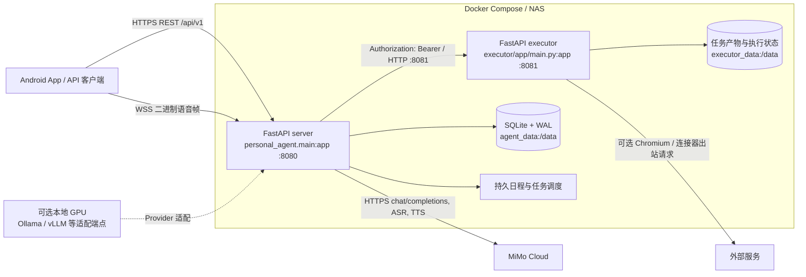

# 架构说明

## 1. 目标

Rana Agent 对标 Dot 的持续在线个人助理体验：对话不是孤立请求，而是可以关联长期目标、持久任务、日程、记忆、连接器和审批。系统默认自托管 SQLite 数据与执行器，模型层支持小米 MiMo 与 MiniMax；本地 GPU 是 Provider 层的可选扩展，而不是基础运行依赖。

## 2. 组件视图



生产 Compose 只发布 server 的端口。executor 没有宿主机端口映射，server 与 executor 共享内部令牌；`backend` 网络是 internal，`frontend` 提供必要出站访问。

## 3. 服务端分层

### API 与认证

- ASGI 入口：`server/personal_agent/main.py`，应用对象为 `app`，健康检查为 `GET /healthz`。
- REST 前缀：`/api/v1`；路由按认证、会话、目标、任务、记忆、日程、审批、设置、活动和连接器拆分。
- 密码使用 scrypt 哈希；access token 是短期 JWT，refresh token 旋转并只保存哈希。
- 数据访问按 `user_id` 做 owner 隔离。设置中的秘密值在 API 输出时脱敏。
- 审批决定与任务状态联动，批准或驳回后由任务管理器恢复相应状态。

### Provider 层

`server/personal_agent/providers/` 隔离模型供应商协议。Agent 运行时依赖的通用契约为：

```python
complete(messages, tools=None, model=None)
# 返回对象包含 content、tool_calls、usage

async for text_delta in stream_chat(messages, model=None):
    ...
```

MiMo Provider 使用 `httpx`，默认聊天端点为 `${AGENT_MIMO_BASE_URL}/chat/completions`，处理 429/5xx 退避，并适配 ASR/TTS 流式数据。`AGENT_MIMO_LLM_MODEL`、`AGENT_MIMO_ASR_MODEL`、`AGENT_MIMO_TTS_MODEL` 和 `AGENT_MIMO_VOICE` 分别选择模型与声音。

本地 GPU 不改动任务、认证或存储层：实现同一个 Provider 契约，接入本地 OpenAI 兼容推理服务即可。当前 `.env.example` 同时声明 MiMo 与 MiniMax 云配置，通过 `AGENT_AI_PROVIDER` 选择；本地推理的 URL、密钥和模型名应由相应适配器新增配置，不应把现有云端 URL 变量误当作已经实现的 Ollama/vLLM 开关。

### 持久任务运行时

`server/personal_agent/services/` 中各组件职责：

| 组件 | 职责 |
| --- | --- |
| `tasks.py` | 目标/任务创建、排队、公平并发、租约、心跳、取消、重试、超时和重启恢复 |
| `agent.py` | Agent 步骤循环，调用 Provider 与工具，保存进度和结果 |
| `scheduler.py` | 持久 cron 日程、时区处理、到期投递 |
| `events.py` | 持久 `TaskEvent` 与进程内 transient event broker |
| `context.py` | 对话上下文、摘要与记忆检索；优先 FTS，回退 LIKE |
| `executor.py` | 调用 executor 的 `/api/v1/execute`，统一超时和内部认证 |
| `voice.py` | 语音会话状态机、ASR → LLM 流 → 分句 TTS、顺序播放和 barge-in |

主要任务管理器契约包括 `start()`、`stop()`、`recover()`、`create_goal()`、`create_conversation_task()`、`cancel()`、`retry()` 与 `resume_after_approval()`。任务状态、事件和日程均落库，进程重启后以数据库为准恢复，而不是只保留内存队列。

### Executor

Executor 是独立 FastAPI 进程，镜像入口工作目录为 `/app/executor`，启动 `app.main:app`。它接收 server 的内部请求，并在线程池、浏览器会话等资源边界内执行任务。Compose 把根 `.env` 的 `AGENT_EXECUTOR_TOKEN` 同时注入 server 的同名变量和 executor 的 `EXECUTOR_TOKEN`，客户端以 `Authorization: Bearer <token>` 调用；server 侧使用 `AGENT_EXECUTOR_BASE_URL=http://executor:8081`，executor 工作目录通过 `WORKSPACE_ROOT=/data/workspace` 持久化。

默认镜像是 slim；合并 `deploy/compose.browser.yml` 后才安装 Playwright/Chromium，并显式传入浏览器启用与无头模式变量。Executor 的 `/data` 与 server 的 `/data` 是两个独立卷，备份与恢复必须成对处理。

## 4. 数据模型与所有权

核心表位于 `server/personal_agent/models.py`：

- 身份：`User`、`AuthSession`。
- 个性化：`Agent`、`Conversation`、`Message`、`Memory`、`Setting`。
- 持续工作：`Goal`、`Task`、`TaskEvent`、`Schedule`、`Approval`。
- 外部能力：`Connection`、`Artifact`。

除全局身份表外，业务记录均带 `user_id` 或经关联实体归属用户。`Goal` 和 `Task` 支持用户范围内幂等键；任务还有优先级、尝试次数、租约、心跳和超时字段。SQLite 连接启用 `foreign_keys=ON`、`journal_mode=WAL` 与 30 秒 busy timeout。

默认数据库 URL 由 `AGENT_DATA_DIR` 推导为 `<DATA_DIR>/agent.db`。Compose 强制数据目录为 `/data`；本地开发默认是 `./data`。不要仅复制正在写入的 `agent.db` 而遗漏 `-wal`，应使用随仓库提供的停机一致性备份脚本。

## 5. 关键流程

### 文本对话

1. Android/客户端登录并携带 access token。
2. 创建或选择会话，写入用户消息。
3. TaskManager 创建与会话消息关联的持久任务。
4. Agent 读取上下文与记忆，调用 MiMo Provider；工具步骤可进入 executor 或审批。
5. 增量事件用于在线展示，最终消息、任务结果与事件写入数据库。
6. 断线重连后通过 REST 读取持久状态，而不是依赖 transient broker 补回全部历史。

### 长期目标

1. 客户端提交标题、输入、优先级和可选幂等键。
2. TaskManager 同事务创建 Goal 与根 Task。
3. 调度器按状态、优先级和创建时间公平领取任务，写租约与心跳。
4. Agent 可创建后续步骤/子任务，失败按 `attempts/max_attempts` 重试，最终错误或结果落库。
5. 服务重启后 `recover()` 处理过期租约与中断任务；用户可取消或重试。

### 实时语音

1. 客户端建立 WebSocket，发送 start 控制消息和带 `turn_id`、`seq` 的二进制音频帧。
2. VAD 或 end 控制结束收音，ASR 生成文本并写入会话。
3. LLM 流式输出按句切分送入 TTS，PCM16 音频按顺序发送。
4. interrupt/cancel 只终止指定回合；新回合使用新 `turn_id`，旧回合晚到的帧不得混入新回合。

详细帧格式见 [VOICE.md](VOICE.md)。

### 审批

高风险工具动作创建 `Approval` 并暂停关联任务。approve/reject 接口记录决定时间与状态，随后调用运行时恢复或重新排队。审批与任务记录都带用户归属，不能靠只修改前端状态完成审批。

## 6. 一致性与故障边界

- **数据库是持久事实来源**：任务、日程、消息和审批重启后仍可查询；`/ws/events` 的持久事件按 TaskEvent ID 游标补发并可由数据库补偿，`message.delta` 等瞬态事件使用 `id=null`，不推进重连游标。
- **外部调用有超时与重试**：MiMo 请求和 executor 请求分别受配置约束；重试必须保留任务幂等语义。
- **回合隔离**：语音取消和中断按 turn 清理，避免旧音频、旧 TTS 与新回合交错。
- **资源隔离**：Compose 限制 CPU/内存，任务池、线程池和浏览器会话数限制应用内并发。
- **一致性备份**：同时停止两个写入方，归档两个卷；恢复前验证压缩包目录并恢复服务。

## 7. Android 与接口边界

Android App 是独立客户端，不直接读取 SQLite，也不直接访问 executor。它只需要 server 的 HTTP(S) 基础地址，统一处理：

- 登录、refresh 旋转与登出；
- 会话、目标、任务、日程、记忆和审批；
- 活动状态与断线后的 REST 重同步；
- 语音 WebSocket 的二进制帧和播放/打断控制。

移动端 `app/` 工程的网络实现应把 API 基础地址做成构建或运行配置；部署文档中的 `NAS_HOST:SERVER_PORT` 是地址来源，不假定某个尚未声明的 Dart 编译变量。

## 8. 发布与扩展

`deploy/server.Dockerfile` 和 `deploy/executor.Dockerfile` 使用 Python 3.12 slim、多阶段虚拟环境和 UID `10001` 非 root 运行。Buildx 可发布 `linux/amd64,linux/arm64`。新增 Provider 或连接器不需要改变部署拓扑；新增需要持久化的数据时，应同时更新卷设计与备份脚本，而不是依赖容器层隐式保存。
